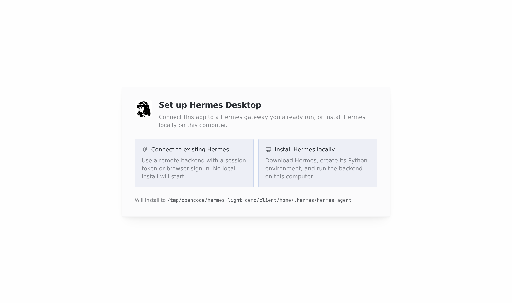
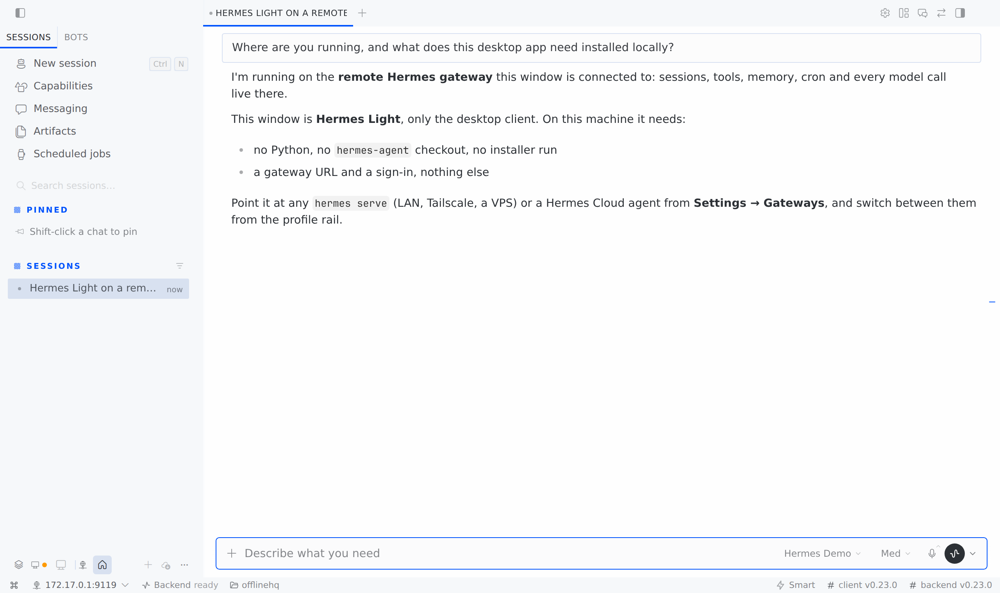
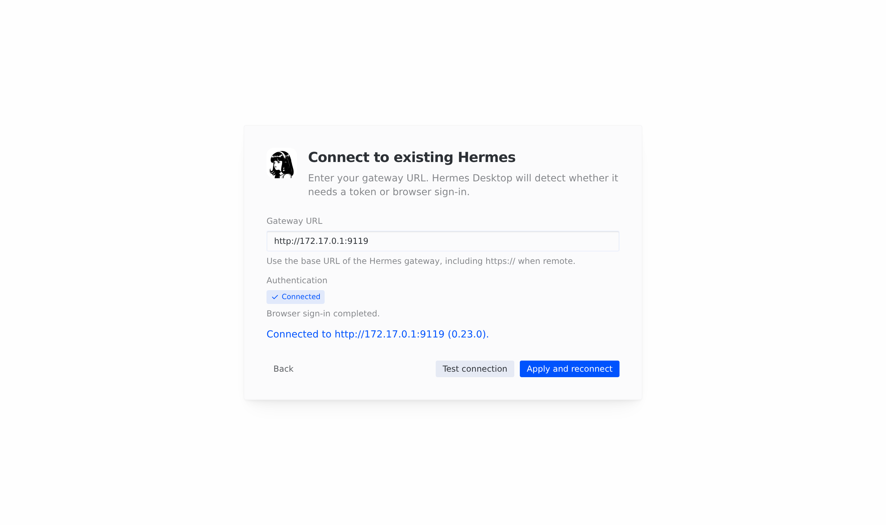
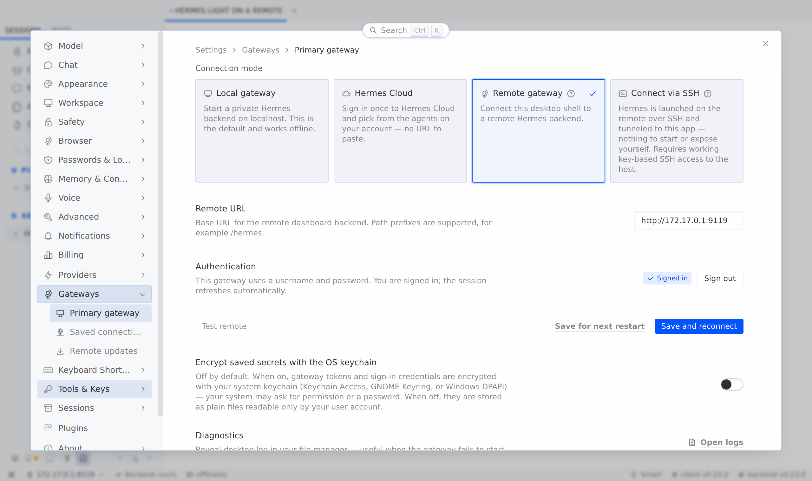

# Hermes Light builds

Unofficial builds of **Hermes Light**, the `light` variant of the
[Hermes Agent](https://github.com/NousResearch/hermes-agent) desktop app: the desktop client
without a bundled agent runtime. It ships no Python and no agent checkout. On first launch,
connect it to a Hermes you already run (a `hermes serve` gateway, an SSH host, or a Hermes Cloud
agent), or install Hermes locally if you choose to. Nothing is installed unless you pick that option.

Upstream has the variant and its build support but publishes no Light release, and its Linux
packaging fails on the current release. This repository rebuilds upstream's light variant for every
upstream stable release, with one build fix and no changes to the app.

**Downloads:** [latest release](../../releases/latest)

| First run | A turn on a remote gateway |
|---|---|
|  |  |
| **Connecting to a gateway** | **Gateway settings** |
|  |  |

| Platform | File |
|---|---|
| Linux x64 / arm64 | `HermesLight-<version>-linux-<arch>.AppImage` |
| macOS Apple silicon / Intel | `HermesLight-<version>-mac-<arch>.dmg` (or `.zip`) |

## Install

**Linux:** `chmod +x HermesLight-*.AppImage` and run it. AppImages need FUSE 2 (`libfuse2` on
Debian/Ubuntu); without it, run with `--appimage-extract-and-run`.

**macOS:** the app is not signed or notarized, so macOS refuses a downloaded copy. Drag it
to Applications, then clear the quarantine flag once:

```sh
xattr -dr com.apple.quarantine "/Applications/Hermes Light.app"
```

The in-app updater has no feed for these builds; download new releases from this page.

Hermes Light keeps its own app identity (`com.nousresearch.hermes-light`), so it can sit next to
the full Hermes app. Like the full app, it keeps its settings, gateway tokens and logs in the Hermes
home (`~/.hermes`).

## Connect it to a gateway

Run the backend on the machine that should do the work, protected by an auth provider, then
choose **Connect to existing Hermes** on the first-run screen and enter its URL. The upstream
guide covers both halves:
[Desktop → Connecting to a remote backend](https://hermes-agent.nousresearch.com/docs/user-guide/desktop#connecting-to-a-remote-backend).
In short, on the backend:

```sh
# username/password for a trusted network or a tailnet; use the Nous OAuth provider on the internet
echo "HERMES_DASHBOARD_BASIC_AUTH_USERNAME=me" >> ~/.hermes/.env
echo "HERMES_DASHBOARD_BASIC_AUTH_PASSWORD=..." >> ~/.hermes/.env
echo "HERMES_DASHBOARD_BASIC_AUTH_SECRET=$(openssl rand -base64 32)" >> ~/.hermes/.env
hermes serve --host <tailscale-or-lan-ip> --port 9119
```

## What the patch changes

[`patches/`](patches) is a `git format-patch` series against the upstream tag. It holds one
build fix and leaves the app untouched:

- **Copied packaging toolsets load as CommonJS.** Upstream's Linux AppImage packaging copies
  electron-builder's icon tool into the desktop package, which is `"type": "module"`, so the
  tool's CommonJS script crashes (`require is not defined in ES module scope`). The fix gives
  the copy its own package scope. Upstream's Linux release legs are disabled, so nothing there
  exercises this path.

## How the builds work

[`.github/workflows/hermes-light.yml`](.github/workflows/hermes-light.yml) runs every six hours.
When upstream has a stable release with no `vX.Y.Z-light` release here, it checks out the tag,
applies the patches and builds on Linux x64/arm64 and macOS arm64/Intel. It then publishes the
artifacts with `SHA256SUMS`. A push that changes the patches rebuilds the current release;
**Run workflow** builds any stable tag.

[`scripts/build-light.sh`](scripts/build-light.sh) is the whole build, and runs the same way
locally:

```sh
git clone https://github.com/NousResearch/hermes-agent && cd hermes-agent
git checkout v0.23.0 && git am ../hermes-light/patches/*.patch
../hermes-light/scripts/build-light.sh . v0.23.0   # -> apps/desktop/release/
```

It packages as the stable tag rather than as a commit build, so the app keeps one identity and
data directory across releases. Upstream's stable path requires a release claim tag; the
script creates one for the patched commit and deletes it afterwards.

## Refreshing the patches

When a new upstream release does not take the patches (or fixes the bug itself), the scheduled
build fails at **Apply patches**. Rebase them, or delete the ones upstream has absorbed, and
export again:

```sh
cd hermes-agent
git switch -c light-patches vX.Y.Z
git am --3way ../hermes-light/patches/*.patch   # resolve, git am --continue
rm ../hermes-light/patches/*.patch
git format-patch --zero-commit --no-signature vX.Y.Z.. -o ../hermes-light/patches/
```
